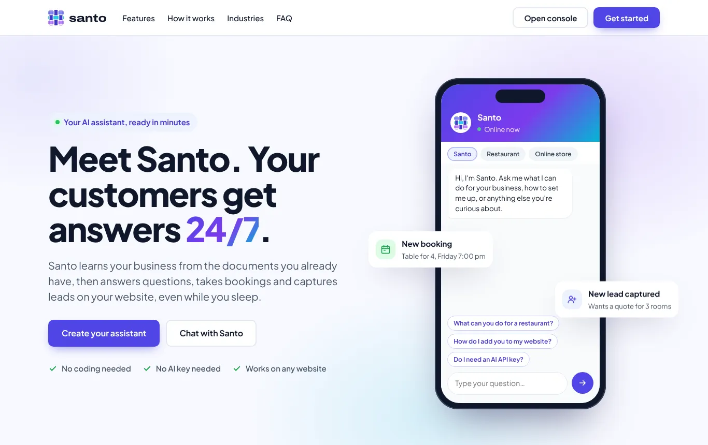
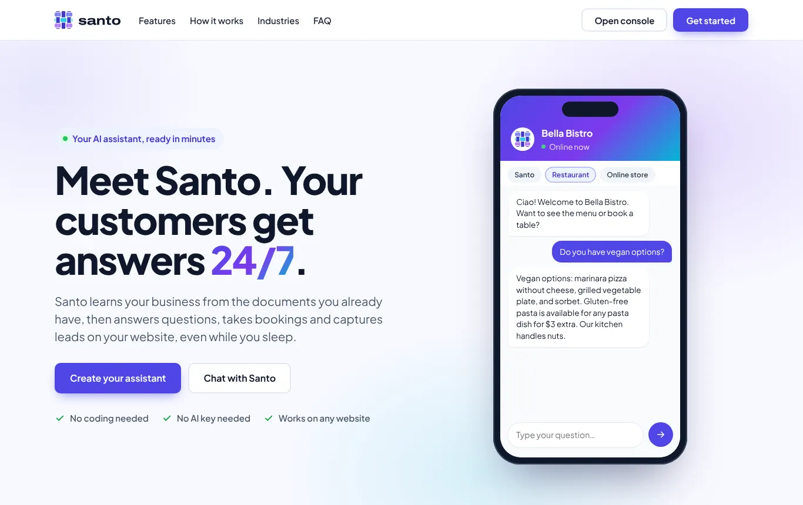
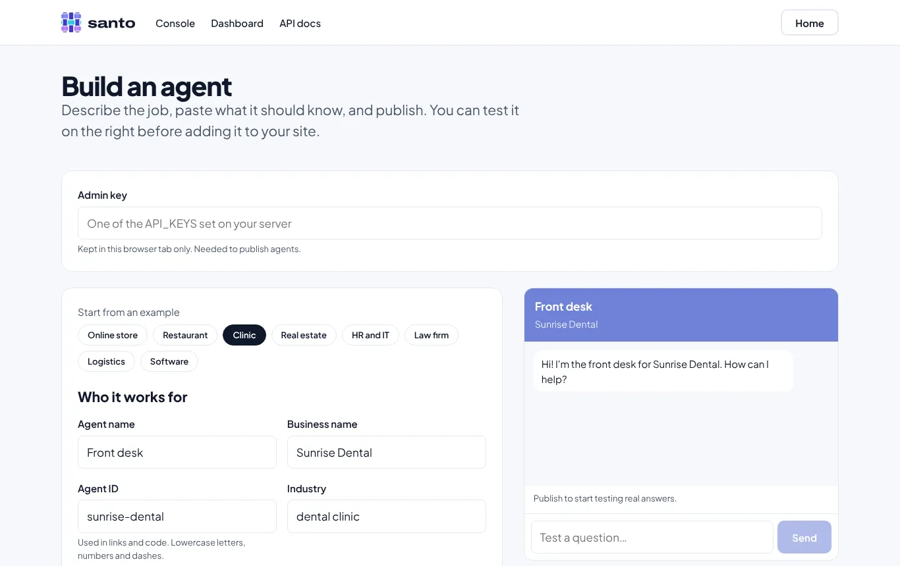
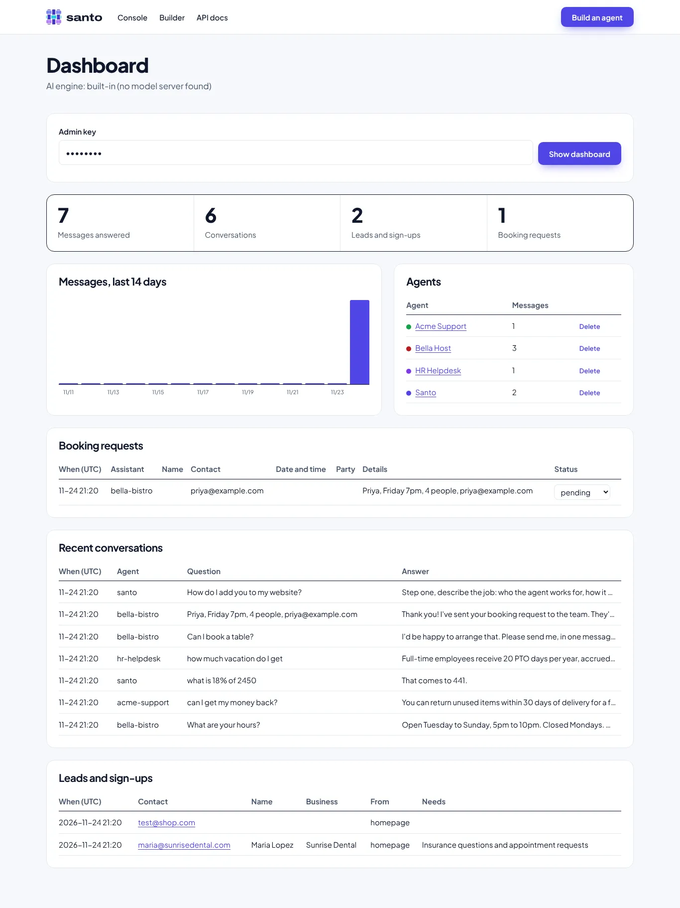
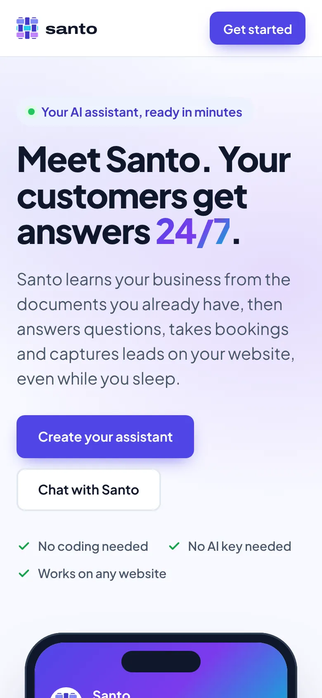

<p align="center">
  
</p>

<p align="center">
  <b>The AI assistant that answers your customers 24/7, built from what your business already knows.</b><br>
  Open-source AI that runs on your own server. No API key, no per-message fees, no coding.
</p>

<p align="center">
  
  
  
  
  
</p>

<p align="center">
  
</p>

---

## What is Santo?

Santo turns a business's FAQs, menus, price lists and policies into an AI assistant. The assistant:

- **answers customers instantly** on the business's website, in its apps, and when other AI tools ask
- **takes booking requests** (tables, appointments, viewings) and **captures leads**
- **answers any question**: business facts come only from the business's own information, and general questions, math and dates are answered too
- **runs on its own open-source AI model** (Qwen 2.5 or Llama 3 via Ollama), so there are no AI accounts or usage fees

It comes as one deployable app: a marketing website, a no-code assistant builder, a chat console, an admin dashboard, an embeddable chat widget, a REST API and an MCP server.

## Screenshots

| Live chat demo | Assistant builder |
|---|---|
|  |  |

| Dashboard | Mobile |
|---|---|
|  |  |

## Features

| | |
|---|---|
| **Keyless AI** | Bundled Ollama model with tool calling. If no model is available, a built-in engine keeps answering, so the site never goes silent |
| **Answers every question** | Your documents for business facts; the model, free Wikipedia/DuckDuckGo lookups, a calculator and the clock for everything else. Optional business-only mode |
| **Semantic search** | Local embeddings (`nomic-embed-text`) blended with BM25 keyword search and synonym matching |
| **Bookings and leads** | Built-in `request_booking` and `save_lead` tools, with booking status you can update from the dashboard |
| **No-code builder** | 8 industry templates (restaurants, online stores, clinics, real estate, HR/IT, law firms, logistics, software); paste knowledge, test and publish |
| **Every channel** | Website chat bubble, REST API with OpenAPI docs, and an MCP server (`/mcp`) so other AI agents can use your assistants |
| **Connect any system** | Declare HTTP tools in YAML to call booking systems, CRMs, order databases, Zapier or n8n. Secrets stay in environment variables |
| **SEO built in** | Sitemap, robots.txt, structured data (Organization, SoftwareApplication, FAQ, breadcrumbs), social share image, and 8 industry landing pages at `/for/<industry>` |
| **Production basics** | API-key auth, public/private assistants, CORS, per-IP rate limiting, SQLite storage, CI tests and auto-deploy workflows |

## Quick start (test on your computer)

**With Docker (full AI).** Install [Docker Desktop](https://www.docker.com/products/docker-desktop/) and give it at least 6 GB of memory.
```bash
cp .env.example .env          # Windows: copy .env.example .env  — then set API_KEYS=test123
docker compose up -d          # first run downloads the AI model (~2 GB)
```
Open **http://localhost:8000**. Check **/health** shows `"ai_engine": "ollama"`.

**Without Docker (quick look, built-in engine).** Needs Python 3.10+.
```bash
python -m venv .venv && source .venv/bin/activate     # Windows: .venv\Scripts\activate
pip install -r requirements.txt
API_KEYS=test123 uvicorn app.main:app --reload        # Windows: set API_KEYS=test123  then  uvicorn app.main:app --reload
```

### Things to try
| Page | URL |
|---|---|
| Homepage with live demo | `/` |
| Build an assistant (admin key: your `API_KEYS`) | `/builder` |
| Dashboard: conversations, bookings, leads | `/admin` |
| Chat console and embed code | `/console` |
| Industry landing page | `/for/restaurants` |
| API reference | `/docs` |

## Create an assistant

**No code:** open `/builder`, pick a template, paste your information and click **Publish agent**.

**As files:** each assistant is one YAML file plus a folder of documents.
```yaml
# agents/sunrise-dental.yaml
name: Front desk
business: Sunrise Dental
domain: dental clinic
answer_mode: open            # or "business" to answer only business questions
knowledge: sunrise-dental    # reads knowledge/sunrise-dental/*.md
greeting: Hi! How can I help you today?
system_prompt: |
  You are the friendly front desk for Sunrise Dental.
  Never give medical advice; give the clinic phone number for emergencies.
http_tools:                  # optional: connect your own systems
  - name: request_appointment
    description: Send an appointment request to the clinic's booking system.
    method: POST
    url: "${BOOKING_WEBHOOK_URL}"
    parameters: { name: {type: string}, phone: {type: string}, time: {type: string} }
    required: [name, phone]
```
Reload without restarting: `curl -X POST localhost:8000/api/admin/reload -H "X-API-Key: $API_KEYS"`. See `agents/TEMPLATE.yaml.example` for every option.

## Add it to any website
```html
<script src="https://heysanto.ai/widget.js" data-agent="bella-bistro"></script>
```
**REST API**
```bash
curl -X POST https://heysanto.ai/api/agents/bella-bistro/chat \
  -H "Content-Type: application/json" \
  -d '{"message": "Do you have vegan options?", "session_id": null}'
```
**MCP:** add `https://heysanto.ai/mcp` as a remote MCP server (header `Authorization: Bearer <API_KEYS>`). Each assistant appears as a tool `ask_<agent_id>`.

## Deploy

| Where | AI model | Notes |
|---|---|---|
| Oracle Cloud Always Free | Yes | Free 2-OCPU / 12 GB Arm server |
| AWS EC2 `t4g.large` | Yes | Use an Elastic IP; choose the Paid plan |
| GoDaddy VPS (8 GB+) | Yes | Same Docker steps |
| GoDaddy Web Hosting (cPanel) | Built-in engine | Uses `passenger_wsgi.py` |

Step-by-step guides for each, plus GitHub auto-deploy, are in **[docs/DEPLOY.md](docs/DEPLOY.md)**.

## Configuration

| Variable | Default | Purpose |
|---|---|---|
| `API_KEYS` | none | Admin password(s), comma-separated. Protects dashboard data, publishing from `/builder`, `/mcp` and private assistants |
| `PUBLIC_AGENTS` | `*` | Assistants usable without a key (website widgets). Keep internal ones private |
| `SITE_URL` | `https://heysanto.ai` | Used for canonical links and the sitemap |
| `CORS_ORIGINS` | `*` | Sites allowed to call the API |
| `OLLAMA_MODEL` | `qwen2.5:3b` | AI model; `qwen2.5:7b` or `llama3.1:8b` on 8 GB+ servers, `qwen2.5:1.5b` on small ones |
| `EMBED_MODEL` | `nomic-embed-text` | Model for meaning-based search |
| `LLM_PROVIDER` | auto | Force `ollama`, `local` (built-in engine), or the optional `anthropic` / `openai` |
| `RATE_LIMIT_PER_MIN` | `30` | Chat requests per visitor IP per minute |
| `DATABASE_PATH` | `data/santo.db` | SQLite file for conversations, bookings and leads |

## Project structure
```
app/
  main.py         API, pages, builder/admin endpoints, MCP server, auth, rate limiting
  llm.py          AI engines (Ollama, built-in, optional clouds) with a tool-calling loop
  tools.py        knowledge search, web lookup, calculator, bookings, leads, HTTP tools
  knowledge.py    semantic + keyword search over knowledge/<agent>/
  db.py           SQLite: conversations, bookings, leads, stats
  seo.py          sitemap, robots.txt, industry landing pages
  config.py       assistant YAML schema and loader
agents/           one YAML file per assistant (santo, bella-bistro, acme-support, hr-helpdesk)
knowledge/        documents per assistant
static/           homepage, builder, console, dashboard, widget.js, styles, fonts, images
tests/            pytest suite, runs offline
docs/DEPLOY.md    hosting guides
future/           pricing section, ready to add back later
passenger_wsgi.py entry point for cPanel hosting
docker-compose.yml  Santo + Ollama + model download
```

## Development
```bash
pip install -r requirements.txt pytest anyio
pytest -q                                   # 26 tests, no network or AI model needed
```
GitHub Actions runs the tests on every push and deploys `main` to your server when the deploy secrets are set.

## Roadmap
- Streaming replies, word by word
- Learn from a website URL, PDF and Word uploads
- Voice input and replies
- Human handoff with email alerts and replies from the dashboard
- Unanswered-questions report
- Plans and billing (`future/pricing-section.html`)

## More docs
- [docs/DEPLOY.md](docs/DEPLOY.md): hosting on Oracle, AWS, GoDaddy and cPanel
- [SEO.md](SEO.md): getting found on Google
- [BRAND.md](BRAND.md): name, logo, colours, fonts and voice

---
© 2026 Santo · [heysanto.ai](https://heysanto.ai)
